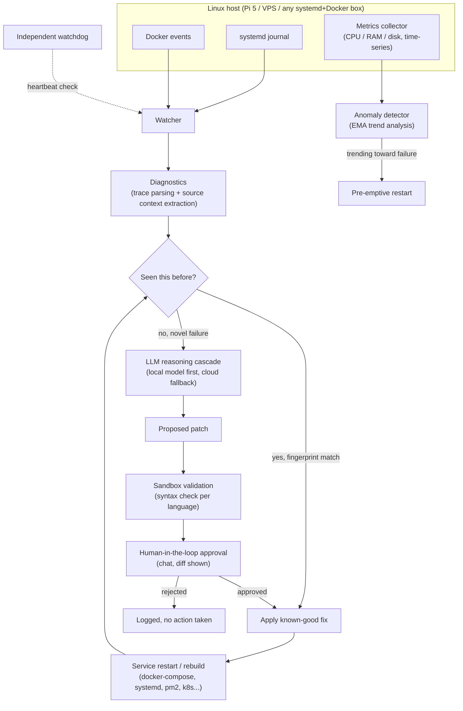

# SRE Daemon

> An autonomous, self-healing agent for Linux servers, watches system and container logs/metrics in real time, diagnoses failures with a multi-tier LLM pipeline, and repairs them safely with a human-in-the-loop approval gate.

**This is a documentation-only repository.** SRE Daemon is closed-source, production software that I built and run on my own infrastructure. The source is not published because I'm developing it toward a commercial product. This repo exists to give recruiters, collaborators, and other engineers an honest look at the system design and the engineering decisions behind it, no source code, install scripts, or proprietary logic is included here.

---

## The problem

Running several self-hosted services on a mix of a Raspberry Pi 5 and a VPS meant getting paged for the same handful of failure modes over and over: a container OOM-killed under load, a stack trace from an unhandled edge case, a slow memory leak that eventually took a service down at 3am. Almost none of these needed a human, they needed someone to notice, understand the failure, and run (or write) the same fix that worked last time.

SRE Daemon is the agent I built to close that loop: notice the failure the moment it happens, work out what's wrong, and either fix it immediately (for known patterns) or draft a fix and ask for a one-tap approval (for anything novel), instead of me finding out about it after the fact.

## What it does

- **Watches** `systemd` journal output and Docker events in real time, and records CPU/RAM/disk metrics for every monitored service on a rolling window.
- **Predicts** failures before they happen, trending resource usage against an exponential moving average and restarting a service pre-emptively when it's about to fall over, instead of waiting for the crash.
- **Diagnoses** the root cause of crashes and errors by extracting the relevant stack trace and surrounding source context and reasoning over it with an LLM.
- **Remembers**: every successfully resolved incident is fingerprinted and stored, so a recurring or similar failure is fixed instantly by replaying a known-good strategy instead of paying for another LLM call.
- **Proposes, never assumes**: any change that touches code is shown as a diff and requires explicit human approval (via chat) before it's applied. Nothing self-modifying happens unsupervised.
- **Validates before applying**: proposed patches are syntax-checked in a sandbox with the appropriate tool for the language before they ever touch a real file, and every change is backed up so it can be rolled back instantly.
- **Watches itself**: an independent watchdog checks the daemon's own heartbeat and restarts/rolls it back if it locks up, so the thing meant to keep other services alive can't become the outage.

## Architecture



## Engineering decisions worth calling out

**Local model first, cloud as fallback.** Every diagnosis attempt starts on a locally-hosted model before ever considering a paid cloud API. The cascade only escalates to a bigger (and more expensive) model when the local one can't produce a confident answer, which keeps steady-state operating cost close to zero.

**Reuse before reasoning.** Before any LLM is invoked at all, the daemon checks whether it has already solved something like this, using exact and fuzzy matching over a registry of past incidents, with older entries weighted down over time so stale fixes don't get reapplied blindly. Most recurring failures never reach the LLM step at all.

**A human stays in the loop for anything that writes code.** Auto-restarting a crashed container is one thing; patching source code is another. The daemon draws a hard line between the two, code changes are always proposed as a diff and require an explicit approval before they're applied, however "obviously correct" the fix looks.

**Fail closed, not open.** Patches are validated in a sandbox before they touch a real file, changes are backed up before being written, and a separate watchdog process supervises the daemon's own health, because a self-healing system that silently breaks itself is worse than no automation at all.

**No hardcoded assumptions about the environment.** Container paths, runtimes (docker-compose / systemd / pm2 / Kubernetes / bare process), and service topology are all discovered at runtime rather than configured by hand, so the same daemon works across a single Raspberry Pi and a fleet of VPS boxes without per-host tuning.

## Sample interaction (illustrative)

```
[docker]     payments-worker exited, OOMKilled (exit 137)
[registry]   fingerprint a1b2c3d, known strategy found, no LLM call
[heal]       executing: docker restart payments-worker
[heal]       ✓ container healthy

[metrics]    api-gateway memory trending 1.6x above baseline (EMA)
[predict]    pre-emptive restart scheduled, avoiding OOM before it happens
[heal]       ✓ restarted cleanly, no downtime observed

[diagnostics] postgres-sync, new traceback, no registry match
[llm]         escalated to reasoning cascade, patch drafted
[approval]    diff sent for review, awaiting human confirmation
[approval]    ✓ approved, patch applied, service rebuilt
[registry]    strategy stored for future reuse
```

## Stack

Python · SQLite · systemd · Docker · self-hosted local LLM inference with cloud LLM APIs as fallback · chat-based approval workflow (Telegram/Slack)

## What this repo is (and isn't)

- **Is:** an architecture write-up and case study, meant to show how the system is designed and why.
- **Isn't:** the source code, an install guide, or a product pitch. SRE Daemon is closed, proprietary software.

If you're an engineer or a hiring team and want to talk through any of the design decisions above in more depth, feel free to reach out via my GitHub profile.
