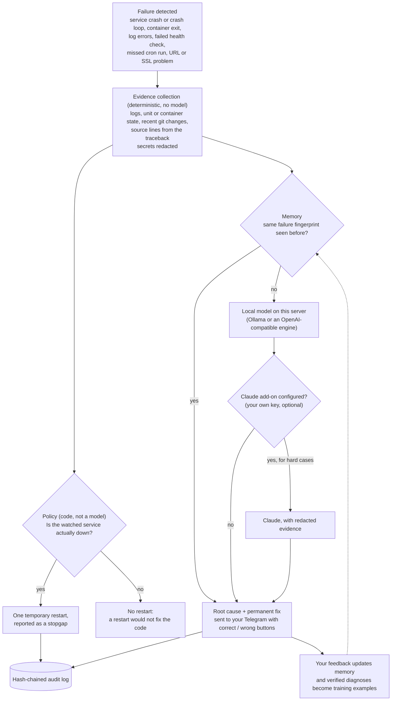

# SRE Daemon

> Root-cause diagnosis on your own Linux server. When a service or container fails, SRE Daemon collects the evidence and a model running on that same machine tells you why it broke and what the permanent fix is.

**Status: beta.** Website, pricing and license keys: **[sre.trihonor.com](https://sre.trihonor.com)**

**This is a documentation-only repository.** SRE Daemon is closed-source, proprietary software. This repo contains no source code, install scripts or model weights. It describes what the product does, how it is built and the engineering decisions behind it.

---

## Contents

- [What it is](#what-it-is)
- [Why local-first](#why-local-first)
- [How it works](#how-it-works)
- [What it watches](#what-it-watches)
- [Security and privacy](#security-and-privacy)
- [Install](#install)
- [How the local model is evaluated and improved](#how-the-local-model-is-evaluated-and-improved)
- [FAQ](#faq)
- [More documentation](#more-documentation)

---

## What it is

SRE Daemon is an agent that runs on your Linux server and watches the services and containers on it. When one fails, it:

1. **Gathers the evidence**: recent logs, systemd unit or container state, recent git changes in the project, and the source lines a traceback points to. Secrets are redacted before any model sees the evidence.
2. **Diagnoses the root cause**: from memory if it has seen this failure before, otherwise with a small open model running locally on the same server. A Claude add-on using your own Anthropic key is optional.
3. **Tells you why**: root cause and permanent fix arrive in your Telegram, with buttons to mark the diagnosis correct or wrong.
4. **Takes one safe action, and only one**: if the service is actually down, it restarts it once as a temporary measure. It never runs commands a model wrote, and it does not change your code.

Monitoring tools tell you *that* something is wrong. SRE Daemon is meant to tell you *why*, pointing at the file and line when the traceback leads into your code. It works alongside the monitoring you already have.

## Why local-first

| | Local model (default) | Claude add-on (optional) |
|---|---|---|
| Where it runs | On your server, through Ollama | Anthropic's API, under your own account |
| Cost | No tokens, no per-incident bill | You pay Anthropic directly for what you use, no markup |
| Your data | Evidence stays on the server | Evidence, with secrets redacted, is sent to Anthropic |
| Hardware | CPU is enough, no GPU. About 1 to 3 minutes per diagnosis on a Raspberry Pi 5-class CPU | No local compute |
| Hard cases | A small open model. Weaker on unfamiliar stacks and multi-step causes, and it can be wrong | Stronger reasoning where the small model struggles |
| The same error again | Answered instantly from memory, at zero cost | Same |

The reasoning behind this split:

- **Privacy by default.** Logs and source code are among the most sensitive data a company has. Diagnosing on the machine where they already live means no AI provider receives anything unless you add your own key.
- **Predictable cost.** A crash loop at 3 a.m. should not produce a token bill. The local model costs nothing per incident, and recurring failures are answered from memory.
- **A wrong answer must be cheap.** A small model will sometimes be wrong. The design makes sure that costs you a misleading message, never a broken server (see [Policy is code](#policy-is-code-not-the-model)).

Besides Ollama, the daemon can use OpenAI-compatible inference servers (for example the llama.cpp server) as additional local engines. A new incident goes to an idle engine instead of queueing behind a busy one.

## How it works



### Diagnosis order: memory, local model, optional Claude

- **Memory.** Each error is reduced to a fingerprint that ignores what changes between occurrences (timestamps, numbers, IDs, container hashes). A diagnosis you confirmed is reused for that fingerprint. An unconfirmed one is reused only while the code has not changed; after a deploy the error is diagnosed again. Marking a diagnosis wrong removes it.
- **Local model.** A small open model served on the same machine. It cannot browse your repository, so the evidence includes the source lines that the traceback points to. Only source files are pulled in this way, so a crafted log line cannot pull configuration files into the prompt.
- **Claude add-on (BYOK).** Optional, with your own Anthropic key, for cases the small model struggles with. Without a key, nothing is sent to any AI provider.

### Policy is code, not the model

Deterministic rules decide every action:

- Restart a watched service **only if it is actually down**, and report the restart as a temporary measure next to the root cause.
- If the service is up but throwing errors, do not restart it. Explain why it fails instead.
- **Never run commands a model wrote.** The permanent fix is explained, not applied. An optional draft pull request with the fix exists, is off by default, and is always reviewed and merged by a human.

Logs and container output are attacker-controllable (request paths, user agents, form fields all end up in logs). Evidence is passed to models as fenced, untrusted data, and text that looks like instructions to an AI is flagged. Because the model's output never becomes a command, prompt injection can at worst produce a misleading message.

An illustrative replay (service names and timings are examples):

```
03:02:12  [DOCKER]     payments-worker exited, OOMKilled (exit 137), service down
03:02:13  [EVIDENCE]   container state, last log lines, 1 commit since last healthy start,
                       traceback -> worker/cache.py:41
03:04:01  [LOCAL]      diagnosed on this server, 0 tokens
03:04:01  [ROOT CAUSE] a recent commit added an in-process cache with no size limit (cache.py:41);
                       memory grows per job until the kernel kills the process
03:04:01  [FIX]        bound the cache (LRU with a max size) or move it out of process;
                       explained, your code untouched
03:04:02  [POLICY]     container was down -> one temporary restart; will recur until the cache is bounded
03:04:02  [TELEGRAM]   diagnosis sent, correct / wrong buttons
2 days later [MEMORY]  same OOM in payments-worker -> answered from memory, instant, 0 tokens
```

More detail: [docs/architecture.md](docs/architecture.md).

## What it watches

- systemd services, including crash loops
- Docker containers
- journald errors
- Application log files
- Health checks
- Cron jobs that stop running
- URL uptime and SSL certificate expiry

**Runs on** Debian, Ubuntu, Raspberry Pi OS (Pi 5), Fedora and RHEL with systemd, on bare metal, a VPS or a cloud VM. Kubernetes is planned, not supported today.

## Security and privacy

An agent that can restart your services is itself an attack surface. Its permissions are therefore set by the installer and enforced by the operating system, not by what a model decides.

| Control | What it means |
|---|---|
| Own system user | Runs as a dedicated `sre-daemon` user in a hardened systemd service. Not root, not in the `docker` group. |
| Restarts only what it watches | A polkit rule allows restarting the services selected at install time, and nothing else. |
| Reads code, not secrets | Read-only access to your project directories for diagnosis. `.env` and key files are not readable. The rest of `/home` is hidden from the service. |
| Docker through a filtering proxy | Docker-group membership is effectively root, so the daemon gets a proxy socket instead: it can read containers and restart them. Creating containers, `exec`, builds, volumes and networks are refused. Environment variable values are stripped from container inspect responses. |
| Signed releases | Every release is signed with an ed25519 key. The public key is pinned at install time and never taken from a download, so a compromised download server cannot sign its own update. |
| Pinned dependencies | Python dependencies are installed from a lock file with hash checking. |
| Managed updates with rollback | A daily timer installs new signed releases, keeps the previous version and rolls back automatically if the daemon does not come back. Can be turned off. |
| Hash-chained audit log | Every action is appended to a log where each entry is chained to the previous one, so an edited or removed entry shows. |

**What leaves the server**

- Alerts and diagnoses go to your own Telegram bot.
- The hosted dashboard receives incident metadata (service, title, status), host metrics and usage counts. Logs and diagnosis details are shared only if you opt in.
- Evidence goes to Anthropic only if you add your own key for the Claude add-on.

Full threat model and limits: [docs/security.md](docs/security.md).

## Install

You need a license key. Plans are **Pro** (€49/month incl. VAT, 14-day free trial) and **Scale** (€149/month incl. VAT, up to 10 servers). Get a key at **[sre.trihonor.com](https://sre.trihonor.com)**; it arrives in your welcome email.

Then, on a Linux server with systemd, one command (about 3 to 4 minutes):

```bash
curl -fsSL https://sre-api.trihonor.com/install.sh | sudo SRE_API_KEY=<your key> bash
```

The installer:

- checks your key and downloads the signed release;
- creates the `sre-daemon` system user;
- installs Ollama and the diagnosis model (can be skipped);
- finds your Docker containers and systemd services to watch;
- writes the polkit rule and sets up the Docker proxy;
- asks for a Telegram bot and, optionally, an Anthropic key for the Claude add-on;
- starts the hardened service and the daily update timer.

Running the same command again updates the install and keeps your settings. The installer prints the uninstall command when it finishes.

The install path is covered by an end-to-end test suite that installs the product the way a customer would on clean Debian machines (with and without Docker), then checks both safety (the daemon user cannot read `.env`, cannot restart unwatched services, cannot write its own code, cannot `docker run` or `docker exec` through the proxy) and function (a real crash produces a diagnosis and a restart, and re-installing keeps customer settings).

## How the local model is evaluated and improved

Shipping a small model is only honest if you measure it. The rules:

- **Held-out gold set.** 68 hand-written incidents from stacks the model was never trained on: 46 real incidents and 22 non-incidents (noise that should not raise an alarm). Evaluation runs at temperature 0 with a fixed seed, because an earlier 30-case set at non-zero temperature moved by about ±5 between runs of the *same* model, which is larger than the differences being measured.
- **A model is switched only when it wins.** A candidate replaces the production model only after it beats it on the held-out set.
- **Learning loop.** Verified diagnoses (your correct / wrong taps, or an outcome that held) and labels from a larger teacher model become training examples. A weekly job trains a candidate and evaluates it against the current model; the switch requires human approval.

**What this means in practice.** The fine-tunes trained so far did not beat the base model on the held-out set (the first called almost everything an incident, because its labels were nearly all real incidents; the second overcorrected), so production keeps the base model until a candidate wins. What improves it is balanced, verified data with both outcomes, which the live feedback loop collects.

## FAQ

**Does any data leave my server?**
The diagnosis does not: evidence is collected and analysed on the server. Alerts go to your own Telegram bot; incident metadata, host metrics and usage counts go to your dashboard; the redacted evidence goes to Anthropic only if you add your own key.

**Do I need a GPU?**
No. The local model runs on the CPU. On a Raspberry Pi 5-class CPU a diagnosis takes about 1 to 3 minutes, and an error it has seen before is answered from memory instantly.

**What if the model is wrong?**
It will be, sometimes. That is why a model never controls what happens. The only automatic action is deterministic (restart a watched service that is actually down). Mark the diagnosis wrong and memory forgets it; add the Claude add-on if you want a stronger second opinion on hard cases.

**Will it restart things blindly?**
No. It restarts a service only when it is down. If the service is up but erroring, a restart would not fix the code, so it explains the cause instead.

**Does it change my code?**
No. It reads your project code and explains the permanent fix. A draft pull request is an option that is off by default; you review and merge.

**Is there a free plan or a free self-hosted version?**
No. SRE Daemon is available on paid plans only. Pro includes a 14-day free trial.

**Why is the source not public?**
SRE Daemon is a commercial product. This repository documents the design so you can judge it before you install it.

**How is this different from PagerDuty or Datadog?**
Those tell you that something is wrong, and you can keep using them. SRE Daemon runs on the server itself and tells you why.

## More documentation

- [docs/architecture.md](docs/architecture.md): components, evidence collection, memory, engines, update path
- [docs/security.md](docs/security.md): threat model, privilege boundaries, supply chain, known limits
- Website, pricing, privacy policy and terms: [sre.trihonor.com](https://sre.trihonor.com)

## License

Documentation only. See [LICENSE](LICENSE). No license is granted to the SRE Daemon software described here.
