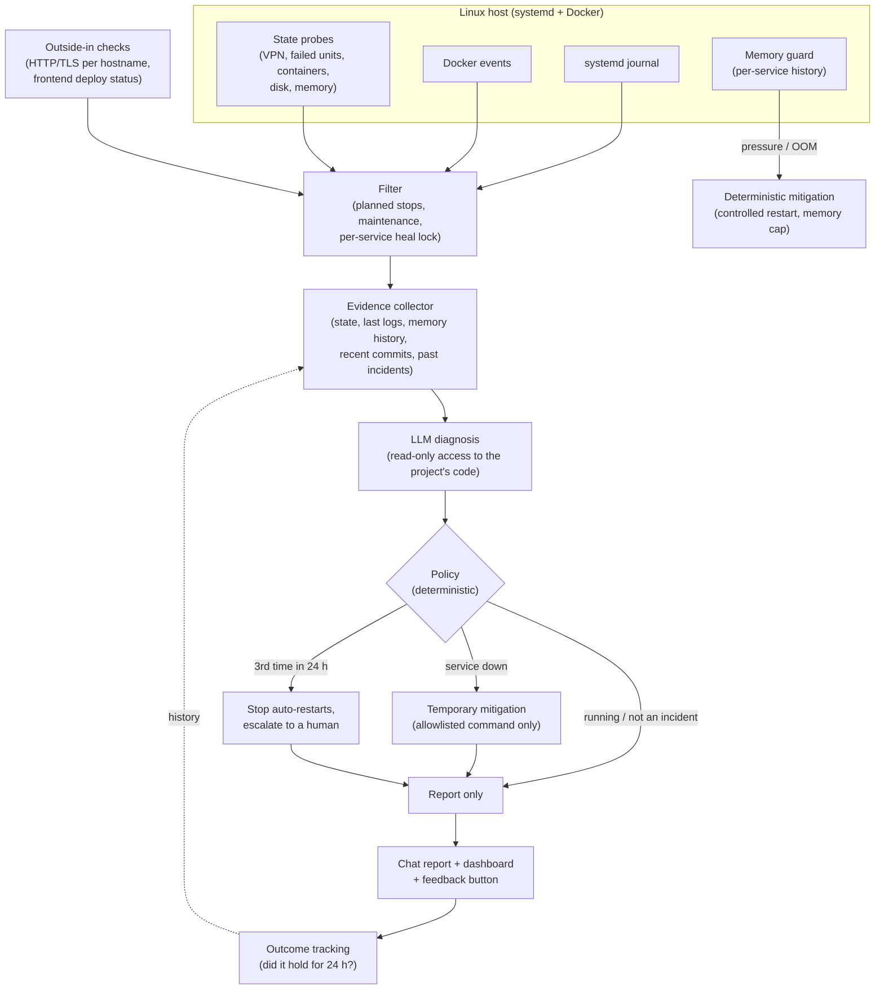

# SRE Daemon

> An autonomous SRE agent for self-hosted Linux servers. It notices failures (including the silent ones), diagnoses the root cause with an LLM that can read the affected project's code, applies only safe, deterministic mitigations on its own, and brings a concrete permanent fix to a human.

**This is a documentation-only repository.** SRE Daemon is closed-source software that I build and run on my own infrastructure and am developing toward a commercial product. This repo gives recruiters, collaborators and other engineers an honest look at the system design and the engineering decisions behind it. No source code, install scripts or proprietary logic is included.

---

## The problem

I run a couple of dozen self-hosted services (APIs, web apps, databases, a password manager, a Cloudflare tunnel) on a Raspberry Pi 5, plus frontends on Vercel. The failures repeat: a container OOM-killed under load, an unhandled edge case in a new deploy, a slow memory leak that takes the whole host down at night, a VPN that quietly logs itself out.

Most of these don't need a human to *act*, but they do need someone to *notice*, understand what actually went wrong, and fix the cause rather than the symptom. SRE Daemon is the agent I built to close that loop.

## What it does

- **Watches events:** the `systemd` journal and Docker events in real time.
- **Probes state, not just logs:** every five minutes it checks things that fail without printing an error: VPN backend state and key expiry, failed systemd units, containers that stopped, are unhealthy or restart-loop, disk and memory pressure.
- **Watches from the outside:** HTTP and TLS checks for every public hostname (auto-discovered from the tunnel configuration) and every frontend project (auto-discovered from the hosting provider's API), plus failed production deploys.
- **Guards memory:** per-service memory history detects slow leaks with a growth rate and a time-to-exhaustion estimate, relieves pressure with a controlled restart *before* the kernel's OOM killer freezes the host, and puts a memory cap on the offending service so the next leak can only take down that service.
- **Diagnoses before it acts:** for a real incident it collects evidence and asks an LLM for a root-cause analysis. The model runs inside the affected project's directory with read-only tools, so it can open the source file a stack trace points to or the commit that shipped an hour ago.
- **Mitigates only when the service is actually down:** a running service that logs an error gets a diagnosis, not a restart. A restart is reported as a temporary mitigation, never as the fix.
- **Escalates repeats:** if the same service fails for the third time in 24 hours, automatic restarts stop and the permanent fix goes to a human.
- **Learns from outcomes:** every incident records whether its resolution held for 24 hours. Past incidents and their outcomes are fed back into the next diagnosis, so a fix that didn't hold is not proposed again.
- **Reports like an on-call engineer:** one message per incident (updated in place as it progresses) with what happened, user impact, root cause and evidence, the permanent fix and the decision taken; a one-tap "was this diagnosis right?" button; and a daily health digest.

## Architecture



## Engineering decisions worth calling out

**The LLM diagnoses, deterministic code decides.** An earlier version asked the model "which command should I run?". In practice the answer was almost always "restart", and only about half of those restarts worked. Now the work is split: code detects, filters, collects evidence and applies a fixed policy; the model does what it is actually good at (reading logs and code, correlating them with recent changes, explaining the cause and proposing a permanent fix). The model never executes anything.

**Read-only, sandboxed access for the model.** During diagnosis the model can only read, grep and glob inside the project directory. Reading `.env` files, keys and other secret files is explicitly denied, and everything sent to a provider passes a redaction layer for API keys, tokens, JWTs, private keys, URL credentials and e-mail addresses.

**Allowlist, not denylist, for commands.** Mitigation commands must match a short allowlist (container and unit restarts or rebuilds), and an unconditional denylist rejects the rest, including anything that would stop or restart the daemon itself or take a service offline. Earlier the model could approve new patterns on its own; that is now off by default after it once approved restarting the daemon.

**Prefer facts the system already knows over guesses.** Compose commands are resolved from the container's own labels (project directory, compose file, compose service name) instead of a model-guessed path. Tunnel hostnames come from the tunnel's live configuration. Leak detection uses measured history, not a single threshold.

**Bring your own model.** The provider order is configuration: a local model, cloud APIs with the customer's own keys, or a subscription CLI. When no model is available a small local model does short triage, and when nothing is available at all the deterministic policy still runs; it just can't write a diagnosis.

**Fail closed.** Per-service heal locks and cooldowns prevent restart storms, memory caps are never set below current usage, privileged operations go through a narrowly scoped polkit rule instead of sudo (the daemon runs with `NoNewPrivileges`), rollbacks stash uncommitted work instead of discarding it, and the daemon's own interventions are rate-limited per service and per day.

## Lessons from running it

These are real incidents from my own infrastructure, each of which changed the design.

- **The restart storm.** One failing service produced a burst of slightly different log lines plus the Docker events from the daemon's own restarts. Deduplication was keyed on the exact error text, so each line started a new healer: one service was restarted more than fifteen times in two minutes and the chat filled with alerts. Fix: one healer per service at a time, a post-heal quiet period, and planned stops (clean exit codes) no longer count as crashes.
- **The silent outage.** A VPN client sat in a "needs login" state for a week. It printed no errors, so a log-based watcher could never see it. Fix: state probes that check *how* things are, not only what they log.
- **The memory lock-up.** An analysis service held a full-resolution copy of every candidate video frame and grew to 13 GB overnight. RAM and swap filled, the host stopped answering SSH and every public site behind the tunnel returned errors until the kernel's OOM killer fired. Fix: per-service leak detection, a controlled restart before the lock-up, and an automatic memory cap after an OOM kill. In the follow-up diagnosis the model located the offending loop and the commit that fixed it by reading the project's code and history.
- **Fixes that never ran.** Two different "the healer can't do anything" bugs went unnoticed for weeks: the allowlist patterns were double-escaped and never matched, and every privileged command failed because the service runs with `NoNewPrivileges`. Both looked like successful runs from the outside. Fix: tests that exercise the real wiring, and verification of every deployed change against the live host.

## Sample interaction (illustrative)

```
[health]     analysis-api: memory 1.0 GB -> 2.2 GB in 2 h (0.6 GB/h, ~18 h to exhaustion)
[memguard]   leak suspected, memory cap set: 4096 MB
[diagnosis]  root cause (high confidence): every candidate frame is copied at full
             resolution in the analysis loop (source file + line cited)
             permanent fix: keep frame indexes only, re-read the selected frames
[decision]   service is running: no restart, fix proposed for review

[uptime]     docs-api: HTTP 502, origin not listening
[diagnosis]  the service was never started after a reboot; no code issue
[decision]   service down: temporary mitigation via its compose project

[docker]     web-app exited (1), third time in 24 h
[decision]   automatic restarts stopped, escalated with the diagnosis and a suspect commit
```

## Stack

Python · SQLite · systemd · Docker · Cloudflare Tunnel · Vercel API · local LLM inference (Ollama) and cloud LLMs with bring-your-own keys · chat-based reporting and approvals (Telegram / Slack)

## What this repo is (and isn't)

- **Is:** an architecture write-up and case study showing how the system is designed and why.
- **Isn't:** the source code, an install guide or a product pitch. SRE Daemon is closed, proprietary software.

If you're an engineer or a hiring team and want to talk through any of these design decisions in more depth, feel free to reach out via my GitHub profile.
