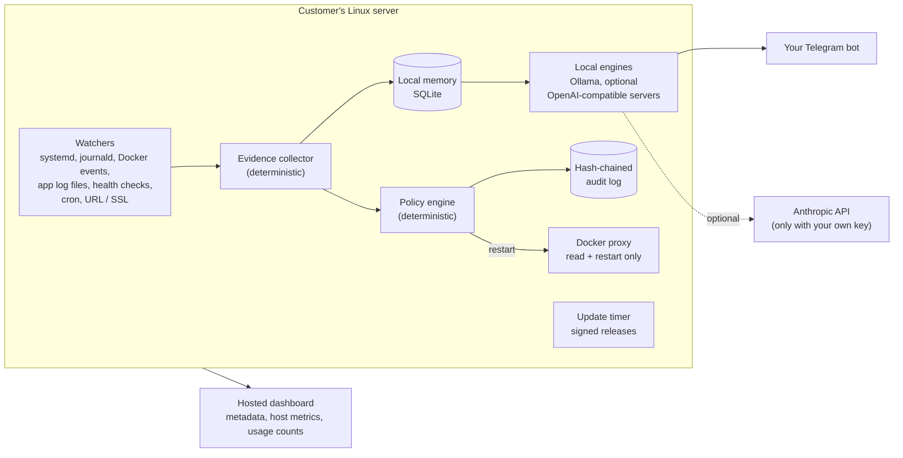
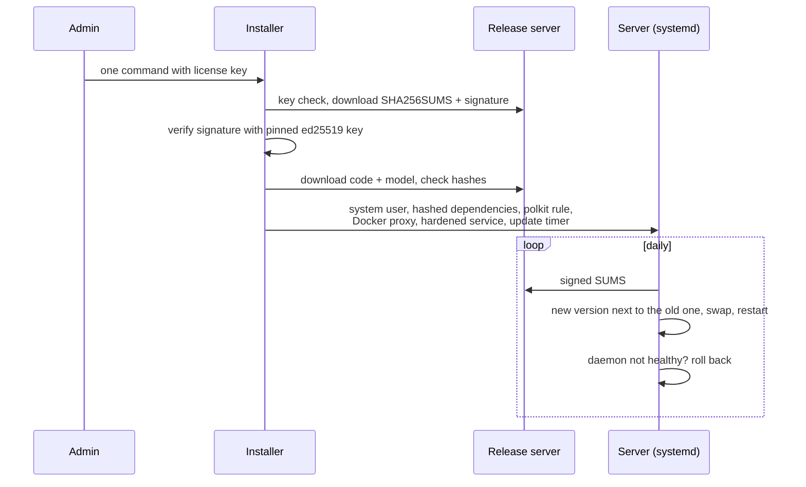

# Architecture

This document describes how SRE Daemon is put together on a customer's server. It covers design, not implementation; no source code is included. Status: beta, so details can change between releases.

## Components on the server

| Component | Role |
|---|---|
| Watchers | Detect a failure: a unit that fails or crash-loops, a container that exits, error lines in the journal or in application log files, a failing health check, a cron job that stopped running, a URL that is down or an SSL certificate about to expire. |
| Evidence collector | Plain code, no model. Gathers recent log lines, unit or container state, recent commits in the project, previous incidents for the same service, and the source lines a traceback points to. Redacts secrets. |
| Policy engine | Plain code, no model. Decides whether the watched service is actually down and whether the incident is recurring. The only automatic action is one temporary restart of a down service. |
| Memory | Local SQLite store of past diagnoses keyed by an error fingerprint, plus a usage ledger (model calls, tokens, calls saved by memory). |
| Local engines | Ollama with a small open model by default. OpenAI-compatible servers (for example the llama.cpp server) can be added; incidents are routed to an idle engine first. |
| Claude add-on | Optional, using the customer's own Anthropic key, for cases the local model struggles with. |
| Docker proxy | A separate service that exposes a restricted Docker socket to the daemon. See [security.md](security.md). |
| Update timer | Daily check for a new signed release of the code and the model, with automatic rollback. |
| Audit log | Append-only, hash-chained record of every action the daemon takes. |

## Incident lifecycle

1. **Detect.** A watcher reports an event for a watched service or container.
2. **Collect evidence.** Deterministic collection, bounded in size. Traceback frames from common languages (Python, JavaScript/TypeScript, Go, Ruby, Java/Kotlin, PHP, Rust, C#, Scala, Elixir) are resolved to the matching source lines in the project. Only source files are read this way, so a crafted log line cannot pull configuration files into a prompt.
3. **Mitigate, if needed.** If the service is down, the policy engine restarts it once and records that this is a stopgap. If it is up but erroring, nothing is restarted.
4. **Diagnose.** Memory first, then the local model, then (only if configured) Claude. The model receives the evidence as fenced, untrusted data and returns a structured answer: is this a real incident, the root cause, the permanent fix, and which file it concerns.
5. **Report.** Root cause and fix are sent to the customer's Telegram with correct / wrong buttons. The permanent fix is explained, not applied. An optional draft pull request is off by default.
6. **Learn.** The customer's feedback updates memory and produces training examples (see below).

## Memory

The fingerprint of an error strips what varies between occurrences: timestamps, numbers, IDs and container hashes. Reuse rules:

- **Confirmed** diagnoses (a correct tap, or an outcome that held) are reused for the same fingerprint.
- **Unconfirmed** diagnoses are reused only while the code is unchanged (same git revision and running image). After a deploy the error is diagnosed again.
- A **wrong** tap removes the diagnosis.

A recurring error is therefore answered instantly and at no cost, without letting a stale answer outlive the code it was about.

## Model lifecycle

- The production model is a small open model, quantized to run on a CPU. It is distributed and updated through the same signed release channel as the code.
- Every new diagnosis is stored as a potential training example. Labels come from verified outcomes and from a larger teacher model.
- A weekly job trains a candidate and evaluates it against the production model on a held-out gold set (68 hand-written incidents from unseen stacks, temperature 0, fixed seed). A candidate is proposed only if it wins, and switching requires human approval.
- As of 21 October 2026 the base model is in production because the first fine-tunes did not beat it. See the [README](../README.md#how-the-local-model-is-evaluated-and-improved) for the numbers.

## Install and update path

Code lives in a root-owned directory the daemon cannot write to. Settings and state live in a directory private to the daemon user. Re-running the installer updates the code and keeps the settings.

## Testing

Besides unit tests, an end-to-end suite installs the product exactly as a customer would, into fresh systemd-based Debian machines with and without Docker. It checks the privilege boundaries (see [security.md](security.md)), that a real crash produces a diagnosis and a restart, and that re-installing keeps the customer's settings. It prints a pass/fail table and fails on any regression.
